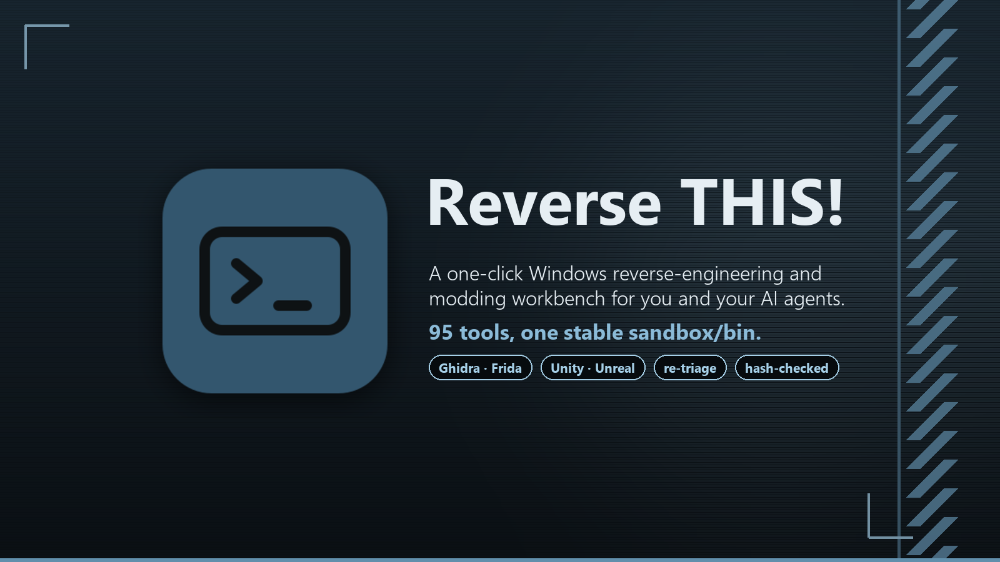
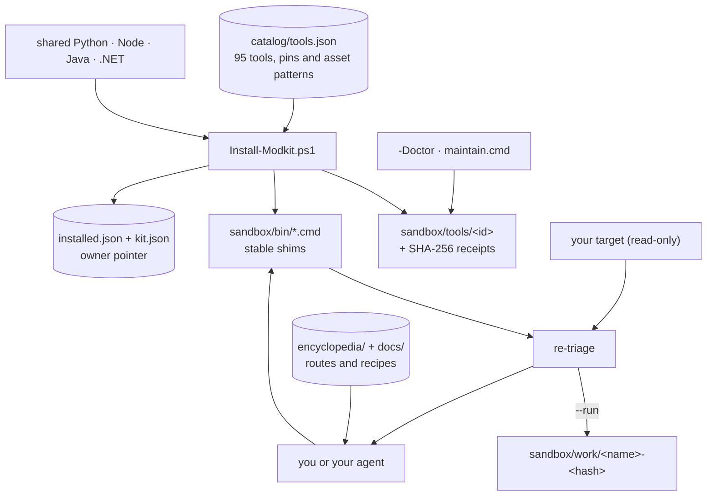

<div align="center">



[](https://github.com/SenjuWoo/reverse-this/actions/workflows/ci.yml)
[](https://github.com/SenjuWoo/reverse-this/releases/latest)
[](Install-Modkit.ps1)
[](catalog/tools.json)
[](LICENSE)

**[Install](#install)** · **[Triage](#start-with-triage)** · **[What it covers](#what-it-covers)** · **[Maintenance](#self-maintaining-by-default)** · **[How it works](#how-it-works)** · **[Changelog](CHANGELOG.md)**

</div>

Reverse THIS! installs the useful parts of a reverse-engineering bench in one place: Ghidra, x64dbg, Frida, decompilers, Unity/Unreal extractors, archive tools, game-specific converters and stable command shims in `sandbox/bin`. Your agent reads the catalog, picks the right tool and follows a documented route instead of guessing.

It is the **reverse-engineering add-on** for the [Ultimate AI Starter Bundle](https://github.com/SenjuWoo/Ultimate-AI-Starter-Bundle). The Bundle is the recommended foundation for shared runtimes, providers and skills; Reverse THIS! also installs and runs alone when you already have your own harness.

## What you get

- **One click, one stable path.** `install.cmd` fetches the catalog into `sandbox/tools` and writes a versionless shim for every CLI into `sandbox/bin`, so an agent calls `sandbox/bin/ghidra.cmd` today and after the next update.
- **A first look that never runs the target.** `re-triage` identifies a file or game folder from its bytes, lists the installed analyzers that read it, and with `--run` executes only the quick read-only ones and keeps their output.
- **Installs you can check.** Release downloads are checked against the publisher's SHA-256 when the release carries one, each install writes a SHA-256 receipt, and `-Doctor` re-hashes them offline. Replaced payloads stay under `sandbox/backups` for rollback.
- **No parallel runtimes.** It reuses a configured shared Python (including `UABS_PYTHON`), Node, Java and .NET instead of installing second copies, and provisions only what is missing.
- **Routes, not just binaries.** Engine fingerprints, a route ladder, Ghidra/Frida/AOB recipes and game field notes live in [encyclopedia/](encyclopedia/) and [docs/](docs/), readable offline.
- **Housekeeping that stays in its lane.** `maintain.cmd` is dry-run by default and only ever touches paths the kit owns.


## Install

```text
git clone https://github.com/SenjuWoo/reverse-this.git
cd reverse-this
install.cmd
```

Or from PowerShell:

```powershell
powershell -NoProfile -ExecutionPolicy Bypass -File .\Install-Modkit.ps1
powershell -NoProfile -ExecutionPolicy Bypass -File .\Install-Modkit.ps1 -Doctor
```

A release ZIP works the same way: extract it and run `install.cmd`.

The first run installs the catalog into `sandbox/tools` and writes stable shims to `sandbox/bin`. It reuses a configured shared Python (including `UABS_PYTHON`), Node, Java and .NET runtime instead of creating parallel copies.

| Option | Does |
|---|---|
| `-Only <id>[,<id>]` | install just those tools |
| `-Plan` | print the catalog; no network, no writes |
| `-Doctor` / `-Offline` | inspect without downloading: re-hash every installed tool and list catalog tools you have not installed as optional, so a kit built with `-Only` passes (a tool named with `-Only` must be present) |
| `-NoUpdate` | keep installed versions; missing selections can still install |
| `-InstallRoot <dir>` | an isolated test kit whose shims and `re-triage` use that kit, not the shared owner |
| `-DebugLog` | detailed diagnostics in `sandbox/log/modkit.log` |

## Start with triage

For a target you have not looked at yet, run `sandbox/bin/re-triage.cmd <file-or-folder>` first. It returns one JSON document: the format and the evidence for it, which analyzers in this kit read that format and whether each is installed, and the exact commands to run next.

```text
re-triage <file-or-folder>                 # identify and route
re-triage <file> --run                     # also run the quick static analyzers
re-triage <file> --run --out <dir>         # keep their output somewhere else
re-triage <file> --run --timeout 60        # seconds per analyzer (default 120)
```

`--run` keeps results under `sandbox/work/<name>-<hash>/triage` unless you pass `--out`. `--timeout` ends the whole process tree a shim started. A tool listed as not installed is a fact to report or fix with `Install-Modkit.ps1 -Only <id>`, not a reason to stop.


## What it covers

| Task | Examples |
|---|---|
| Native and .NET analysis | Ghidra, x64dbg, PE-bear, DIE, ImHex, ILSpy, dnSpy, Rizin |
| Instrumentation and tracing | Frida, RenderDoc, capa, FLOSS, YARA, MinHook, SafetyHook |
| Unity and Unreal | AssetRipper, UABEA, UnityPy, FModel and FModel MCP, repak, retoc, UE4SS |
| Web APIs | Reverse API Engineer (`reverse-api-engineer`, optional) |
| Archives and formats | 7-Zip, QuickBMS, Kaitai, wasm-tools, NeoXtractor, `nstool`, RPFM |
| Game routes | League WADs/LTK, Naruto CPK/XFBIN, NeoX NPK, Risk of Rain 2 source-to-Unity, Pokémon Switch extraction |
| Java, Android and Python | JADX, Apktool, Vineflower, uber-apk-signer, PyInstaller extractors |

The full catalog is [catalog/tools.json](catalog/tools.json), with scope and limits in [docs/coverage.md](docs/coverage.md) and dated version boundaries in [docs/compatibility.md](docs/compatibility.md). Game-specific routes are in [docs/](docs/); engine fingerprints and reusable patterns are in [encyclopedia/](encyclopedia/). The job-to-shim table an agent uses is in [AGENTS.md](AGENTS.md#which-tool).

## A kit, not a silo

Reverse THIS! is deliberately narrow: extraction, inspection, instrumentation and conversion. It does not install game-authoring suites, AI providers, Unity MCPs, image-generation stacks or DCC applications.

| Owner | Owns |
|---|---|
| [Ultimate AI Starter Bundle](https://github.com/SenjuWoo/Ultimate-AI-Starter-Bundle) | Shared runtimes, AI provider wiring, general skills, work hygiene |
| **Reverse THIS!** | REA, analysis/conversion tools, `sandbox/bin`, target workspace, encyclopedia |
| [Skyrim Forge](https://github.com/SenjuWoo/SkyrimForge) and other forges | Game-specific authoring, loaders, records, packaging and deployment |

All three install independently. The bundle’s optional `reverse` pack calls this installer and reuses its `kit.json`; no Reverse THIS! release requires a bundle release. Forge projects may reference this kit’s `7z` and DirectXTex shims instead of installing duplicates.

Reverse THIS! installs **no Skyrim tools** and no game-authoring stack; Skyrim Forge remains the owner. For general mod-loop field notes, see [universal-modder](https://github.com/rehan-remade/universal-modder).

## Self-maintaining by default

```text
maintain.cmd              # report stale kit-owned files
maintain.cmd -Apply       # remove old temp, cache and rollback leftovers
maintain.cmd -UpdateTools # refresh the catalog + run Doctor
maintain.cmd -Test        # packaged catalog/version checks; source catalog/encyclopedia only
maintain.cmd -All         # cleanup + update + tests
```


A ZIP install updates its own source with `powershell -NoProfile -ExecutionPolicy Bypass -File .\Update-ReverseThis.ps1`; from 1.17.1 or older, run the latest release's copy once with `-Destination <your kit folder>` ([details](docs/standalone.md)).

`Maintain.ps1` keeps the newest recovery copies, removes generated junk only under explicitly owned paths (`sandbox/tmp`, `sandbox/backups`, one smoke-run subtree, source `__pycache__`), validates the owner pointer and `installed.json` independently and repairs either record after a move, and never touches target work, tools outside the kit, or system temp. `-Test` in a released ZIP verifies the packaged catalog/version contract; in a source checkout it runs only the catalog and encyclopedia checks. It does not run the installer, isolation, scheduled-task, AOB or Windows delivery suites; use `tests/` for those.

A weekly `maintenance` workflow checks the catalog, encyclopedia and bundle contract without writing to any owner. `Register-Maintenance.ps1` optionally registers a user-scoped weekly task; it is not enabled automatically. It refuses unrecognized tasks, honors `-WhatIf` for run/remove/register, and escapes the scheduled command. Its output is appended to `%LOCALAPPDATA%\ReverseThis\maintenance.log`; remove the task with `Register-Maintenance.ps1 -Remove`. The task records an absolute owner path: after moving the kit, re-register from the new root. The old task then fails visibly if its path is gone; it does not run stale source.

To uninstall, see [docs/standalone.md § Uninstall](docs/standalone.md#uninstall).

## Working with an agent

1. Read `sandbox/installed.json` or `%LOCALAPPDATA%\ReverseThis\kit.json` for the active kit.
2. Pick a tool from the catalog or run `sandbox/bin/<tool>.cmd -h`.
3. Use the matching route in `docs/` or `encyclopedia/`; do not skip the verification step.
4. Write findings to the target workspace, not into the kit.

`AGENTS.md` contains the short operating contract. `docs/reverse-engineering.md` explains the analysis workflow; `docs/standalone.md` covers ownership, updates and isolation.

## Isolated target work

`sandbox` is a workspace folder, not process isolation. When a target needs a separate boundary, use the optional Windows Sandbox launcher on supported Pro, Enterprise or Education editions:

```powershell
.\Start-IsolatedLab.ps1 -Plan
.\Start-IsolatedLab.ps1 -InputFolder 'C:\Lab\Input'
```

The first command prints the configuration without launching or writing files. Tools and optional input are mapped read-only; no target runs automatically. Windows Home users need a separate VM. The launcher does not enable Windows features or reboot the host.

## How it works



- **One owner per machine.** `%LOCALAPPDATA%\ReverseThis\kit.json` names the canonical kit; another checkout reuses it, and `-InstallRoot` test kits never rewrite it.
- **Receipts, not trust.** A cached install must match every file hash in its receipt; changed or missing receipts are rejected and recoverable. Shims carry their own receipts, so Doctor notices a missing, changed or linked shim.
- **Updates keep your choices.** Normal runs update owned release, pip, npm and NuGet tools while preserving pins, newer valid versions and rollback backups.
- **The target stays put.** Triage reads bytes, analyzers write to `sandbox/work`, and nothing in the kit executes a target for you.

## Safety and scope

Tools run with your account’s permissions. This kit does not grant rights to game assets, keys or third-party code, and does not guarantee source recovery, a working build or a bypass of a live service. Use it on software you own or are authorized to test. A catalog entry or successful install is not proof that a particular app can be modified or rebuilt.

## Development and releases

- Source lives in this Git checkout; installed payloads live under `sandbox/` and are ignored.
- Version and changelog are updated together; CI runs catalog, encyclopedia, installer, isolation, entrypoint, runtime, standalone, maintenance and delivery checks under Windows PowerShell 5.1 and PowerShell 7.
- The release workflow builds twice from the exact green commit, requires identical bytes, attests the artifact, publishes it, and re-downloads it to compare.
- Manual maintenance and recovery commands are in [docs/standalone.md](docs/standalone.md); release history is in [CHANGELOG.md](CHANGELOG.md).

## License

MIT for the kit, see [LICENSE](LICENSE). Every downloaded tool keeps its own licence and notices.
